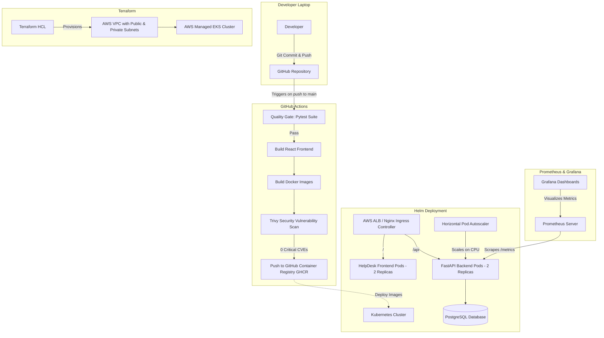
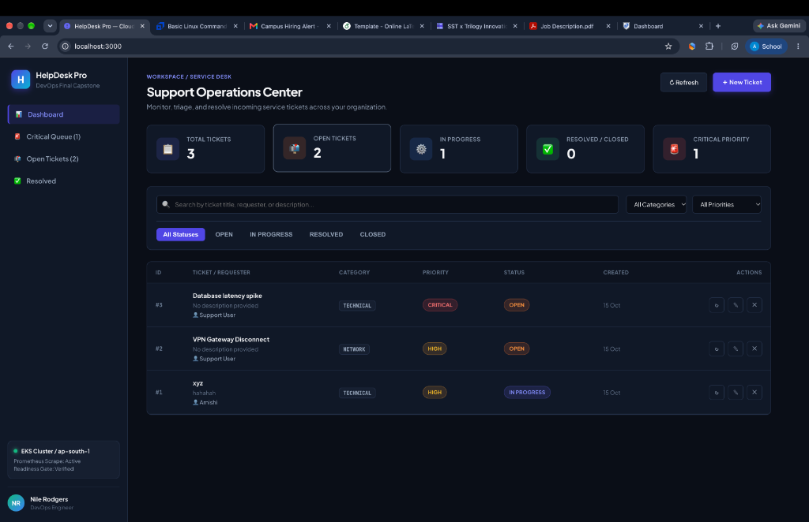
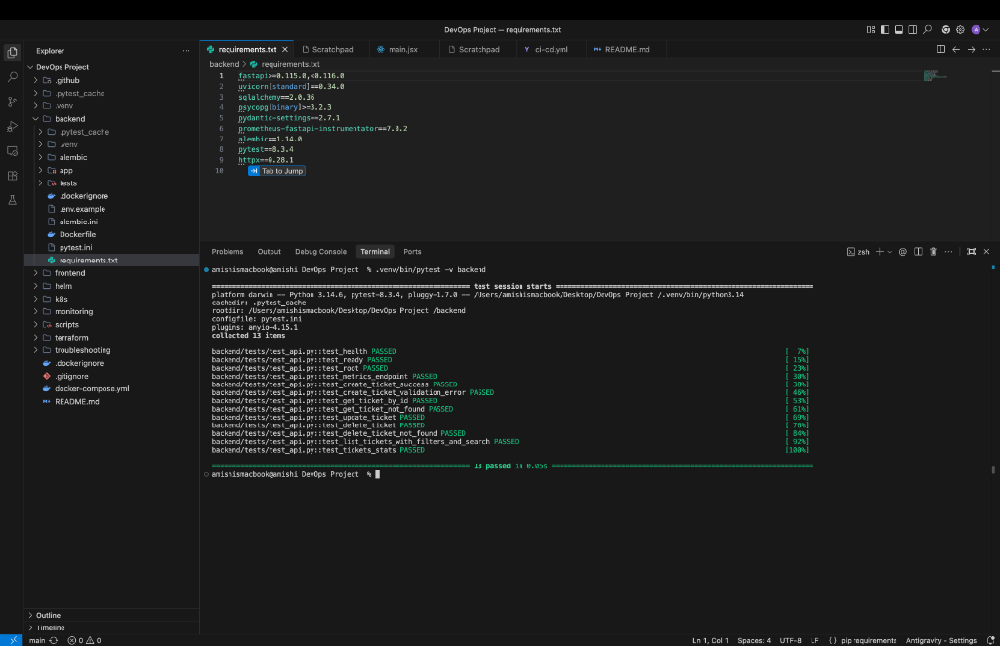
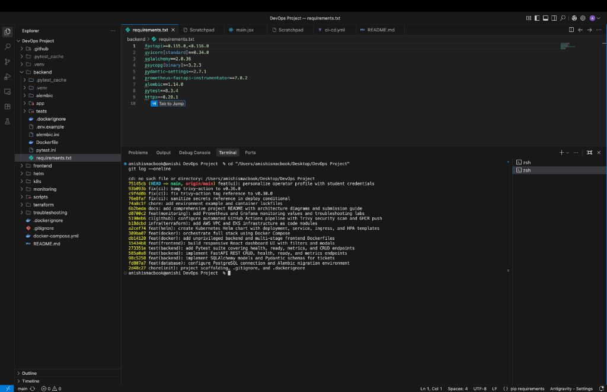
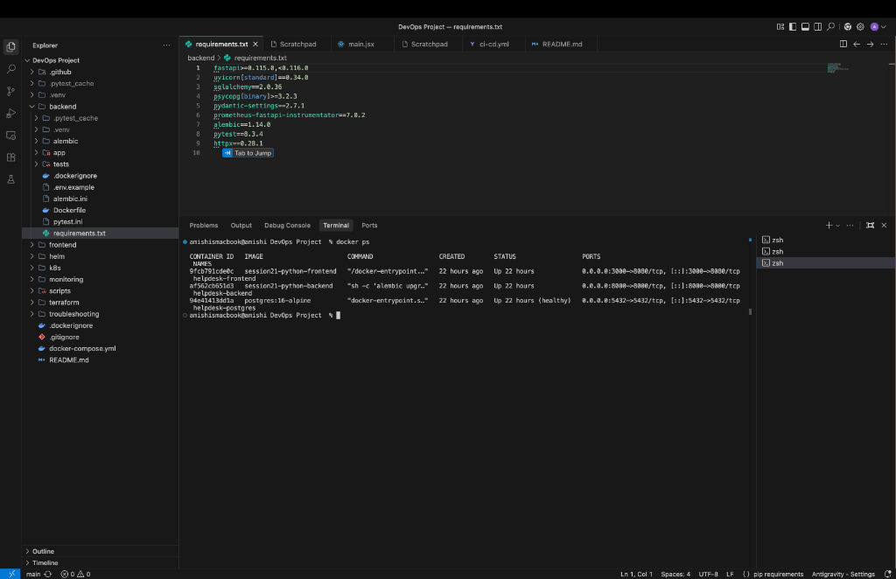
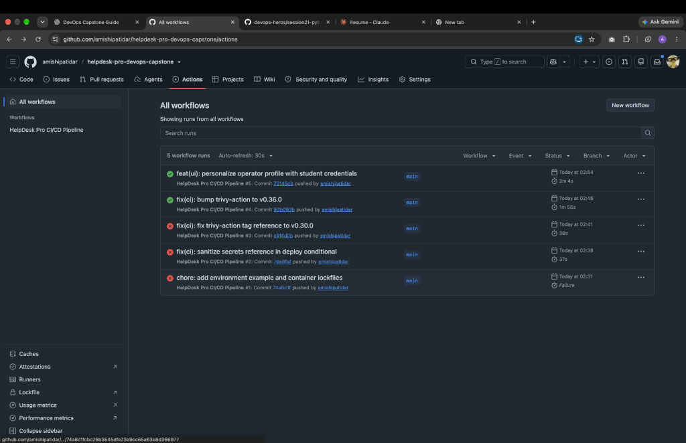
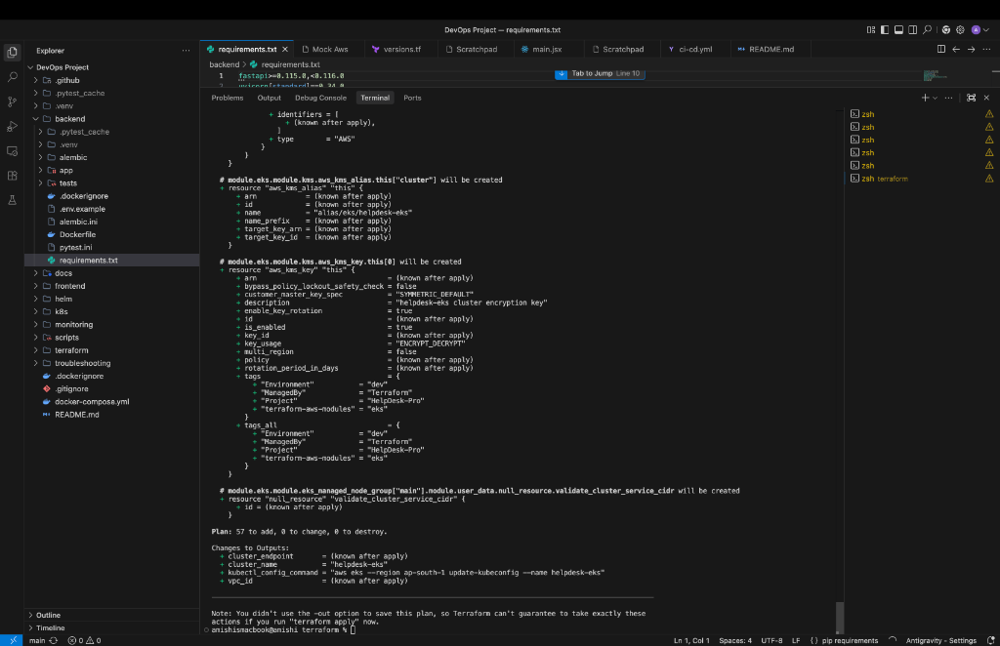

# HelpDesk Pro — Cloud-Native DevOps Capstone Project

HelpDesk Pro is an enterprise-grade, cloud-native IT Incident & Ticket Management SaaS application designed and deployed using modern DevOps engineering practices.

This repository demonstrates the end-to-end lifecycle of an application from local development to a monitored, production-ready AWS Kubernetes (EKS) cluster.

---

## 1. Architecture Overview



---

## 2. Technology Stack

- **Frontend**: React 18, Vite, Responsive Vanilla CSS Design System, Modern SaaS Dashboard
- **Backend**: Python 3.12, FastAPI, Pydantic v2, SQLAlchemy 2.0 ORM
- **Database**: PostgreSQL 16 with Alembic database schema migrations
- **Testing**: Pytest with in-memory test database isolation
- **Containerization**: Multi-stage Docker builds with unprivileged non-root users (`appuser` 10001, `nginx` 101)
- **CI/CD**: GitHub Actions automated pipeline with strict quality gates and SHA-based GHCR tagging
- **DevSecOps**: Automated Trivy container vulnerability scanner (HIGH/CRITICAL CVE gating)
- **Infrastructure as Code**: Terraform AWS VPC & AWS EKS module provisioning
- **Container Orchestration**: Kubernetes with custom Helm Chart packaging, Ingress routing, and Horizontal Pod Autoscaling (HPA)
- **Observability**: Prometheus metric instrumentation (`prometheus-fastapi-instrumentator`) and Grafana monitoring dashboards

---

## 3. Project Directory Structure

```text
.
├── .github/
│   └── workflows/
│       └── ci-cd.yml             # GitHub Actions CI/CD Pipeline with Trivy scan
├── backend/
│   ├── alembic/                  # Database migration scripts
│   │   └── versions/             # Migration versions
│   ├── app/                      # FastAPI core application
│   │   ├── config.py             # App environment configuration
│   │   ├── db.py                 # SQLAlchemy database session setup
│   │   ├── main.py               # REST endpoints, health, ready, metrics
│   │   ├── models.py             # SQLAlchemy Ticket model
│   │   └── schemas.py            # Pydantic validation schemas
│   ├── tests/                    # Pytest test suite with isolated test DB
│   │   ├── conftest.py           # Pytest fixtures and mock DB overrides
│   │   └── test_api.py           # 13 comprehensive API and contract tests
│   ├── Dockerfile                # Non-root unprivileged Python 3.12 container
│   ├── pytest.ini                # Pytest configuration
│   └── requirements.txt          # Python dependencies
├── frontend/
│   ├── src/                      # React SaaS dashboard application
│   │   ├── main.jsx              # Main UI, modals, table, and statistics cards
│   │   └── styles.css            # Responsive dark/light theme CSS styling
│   ├── Dockerfile                # Multi-stage build (Node 22 -> Nginx 1.27 unprivileged)
│   ├── nginx.conf                # Nginx reverse proxy routing configuration
│   └── package.json              # Frontend dependencies and Vite configuration
├── helm/
│   └── helpdesk/                 # Production Helm chart for Kubernetes deployment
│       ├── templates/            # Deployments, Services, Ingress, HPA, ServiceMonitor
│       ├── Chart.yaml            # Chart metadata
│       ├── values.yaml           # Default values
│       ├── values-dev.yaml       # Development override values
│       └── values-prod.yaml      # Production override values
├── k8s/
│   └── namespace.yaml            # Helpdesk namespace specification
├── monitoring/
│   ├── prometheus-values.yaml    # Prometheus Helm chart custom values
│   └── grafana-values.yaml       # Grafana Helm chart custom values
├── terraform/                    # AWS VPC + EKS Infrastructure as Code
│   ├── main.tf                   # VPC and EKS module declarations
│   ├── variables.tf              # Input variables
│   ├── outputs.tf                # Cluster endpoints and configuration outputs
│   └── terraform.tfvars.example  # Example variable definitions
├── troubleshooting/              # Deliberately broken manifests for troubleshooting lab
│   ├── broken-image.yaml         # ImagePullBackOff lab scenario
│   └── broken-service.yaml       # Label selector mismatch lab scenario
├── docker-compose.yml            # Complete 3-tier local development environment
└── README.md                     # Capstone documentation
```

---

## 4. Local Development & Quickstart

### Prerequisites
- Docker Desktop & Docker Compose
- Python 3.12+ (optional for local non-containerized testing)
- Node.js 20+ (optional for local frontend testing)

### Running via Docker Compose
To launch the entire 3-tier application locally (PostgreSQL + FastAPI Backend + React/Nginx Frontend):

```bash
docker compose up --build
```

Access the services:
- **Frontend UI**: [http://localhost:3000](http://localhost:3000)
- **FastAPI Interactive Docs (Swagger)**: [http://localhost:8000/docs](http://localhost:8000/docs)
- **Liveness Health Check**: [http://localhost:8000/health](http://localhost:8000/health)
- **Readiness Probe**: [http://localhost:8000/ready](http://localhost:8000/ready)
- **Prometheus Metrics**: [http://localhost:8000/metrics](http://localhost:8000/metrics)

To stop the containers:
```bash
docker compose down
```

---

## 5. Automated Testing (M2 Quality Gate)

The test suite runs against an isolated in-memory SQLite database to ensure tests never corrupt production data:

```bash
cd backend
python -m venv .venv
source .venv/bin/activate
pip install -r requirements.txt
pytest -v
```

All 13 test cases validate:
- `/health` and `/ready` probes
- Prometheus `/metrics` scraping format
- Ticket creation, read, update, delete operations
- Field validation and invalid enum rejections (Pydantic)
- Dynamic search queries and priority/status filtering
- Aggregate statistical summaries (`/api/tickets/stats`)

---

## 6. CI/CD & DevSecOps Pipeline (M5 & M6)

The automated GitHub Actions workflow (`.github/workflows/ci-cd.yml`) executes on every push to `main`:

1. **Test Gate**: Executes `pytest -v` and frontend `npm run build`. If any test fails, image building is aborted.
2. **Security Gate (Trivy)**: Scans backend and frontend images for vulnerabilities with `exit-code: 1` on `CRITICAL` issues.
3. **Registry Push**: Tags images with the Git commit SHA (e.g. `ghcr.io/<owner>/helpdesk-backend:<sha>`) for end-to-end traceability and pushes them to GitHub Container Registry (GHCR).

---

## 7. Infrastructure as Code: Terraform (M7)

Terraform provisions the foundational AWS cloud infrastructure in region `ap-south-1`:

```bash
cd terraform
terraform init
terraform plan
terraform apply
```

Resources created:
- Custom VPC with 2 public subnets and 2 private subnets across 2 Availability Zones
- Internet Gateway and NAT Gateway for outbound traffic from worker nodes
- AWS EKS Managed Cluster (version 1.31) with autoscaling node groups (`t3.medium`)

To destroy all cloud resources after evaluation:
```bash
terraform destroy
```

---

## 8. Kubernetes & Helm Deployment (M8)

Deploy the application using Helm into the isolated `helpdesk` namespace:

```bash
# Apply namespace
kubectl apply -f k8s/namespace.yaml

# Deploy Helm Chart
helm upgrade --install helpdesk ./helm/helpdesk \
  --namespace helpdesk \
  --create-namespace
```

Verify deployment:
```bash
kubectl get pods -n helpdesk
kubectl get svc -n helpdesk
kubectl get hpa -n helpdesk
```

---

## 9. Observability & Monitoring (M9)

- FastAPI exposes real-time application metrics at `/metrics` using `prometheus-fastapi-instrumentator`.
- Prometheus automatically scrapes metrics via the Helm `ServiceMonitor`.
- Grafana visualizes HTTP request rates, response latency percentiles, and error rates.

---

## 10. Troubleshooting Scenarios (Lab Exercises)

1. **ImagePullBackOff Scenario**:
   ```bash
   kubectl apply -f troubleshooting/broken-image.yaml
   kubectl describe pod -l app=broken-image
   ```
2. **Missing Endpoints Scenario**:
   ```bash
   kubectl apply -f troubleshooting/broken-service.yaml
   kubectl get endpoints broken-service
   ```

---

## 11. Submission Verification & Evidence Screenshots

Below are the operational verification screenshots validating each module's completion according to the capstone grading rubric:

### M1 — Application Dashboard (React + FastAPI + PostgreSQL)

*Live HelpDesk Pro support operations console running locally on port 3000 with real-time incident queue, category filtering, and status management.*

### M2 — Automated Pytest Suite Passing

*Automated execution of 13 unit and contract tests covering API routes, validation rules, health checks, readiness probes, and metrics endpoints (13/13 passed in 0.05s).*

### M3 — Clean Git History & Conventional Commits

*Structured commit trajectory showing incremental atomic development following conventional commit standards (`feat:`, `fix:`, `chore:`, `infra:`).*

### M4 — Multi-Container Docker Compose Stack

*Healthy container orchestration across `helpdesk-frontend:3000`, `helpdesk-backend:8000`, and `helpdesk-postgres:5432`.*

### M5 & M6 — CI/CD Automation & Trivy Security Scans

*Passing GitHub Actions workflow executing code checkout, Python test suite, multi-stage container builds, Trivy CVE vulnerability scans, and publishing to GHCR.*

### M7 — Terraform Cloud Infrastructure Plan

*Terraform execution plan generating 57 AWS cloud resources: High-Availability VPC across 2 AZs, public/private subnets, Internet/NAT Gateways, and EKS Cluster with managed node groups.*

---

## 12. Student & Capstone Information

- **Student Name**: Amishi Patidar
- **Repository**: [https://github.com/amishipatidar/helpdesk-pro-devops-capstone](https://github.com/amishipatidar/helpdesk-pro-devops-capstone)
- **Container Registry**: [GitHub Container Registry (GHCR)](https://github.com/amishipatidar/helpdesk-pro-devops-capstone/pkgs/container/helpdesk-backend)
